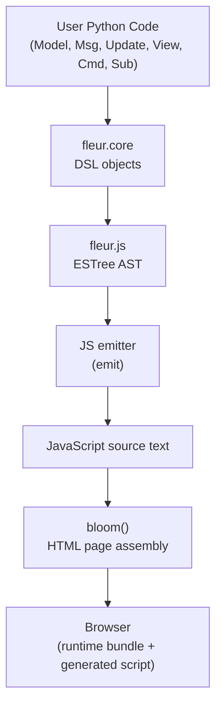
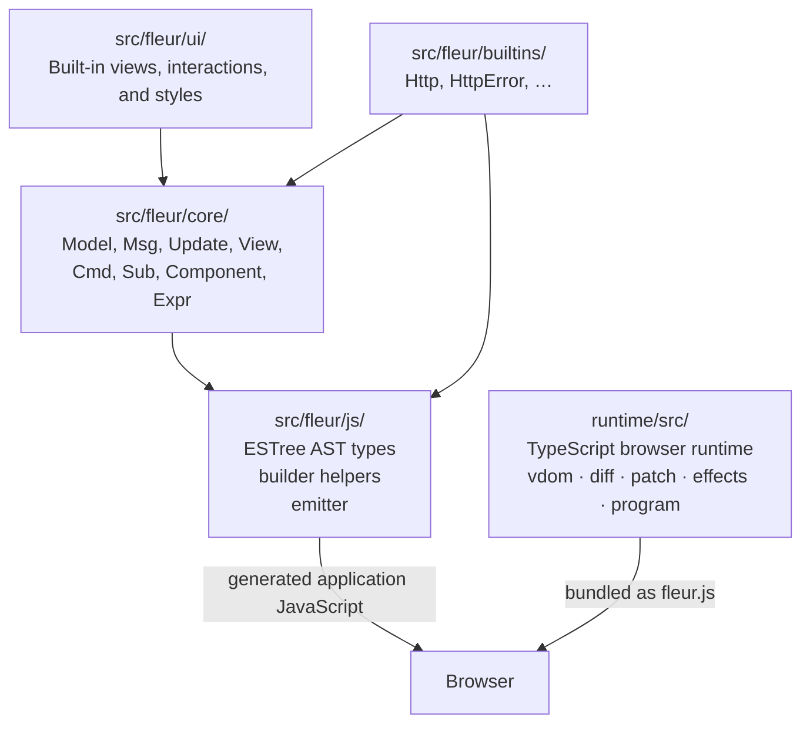
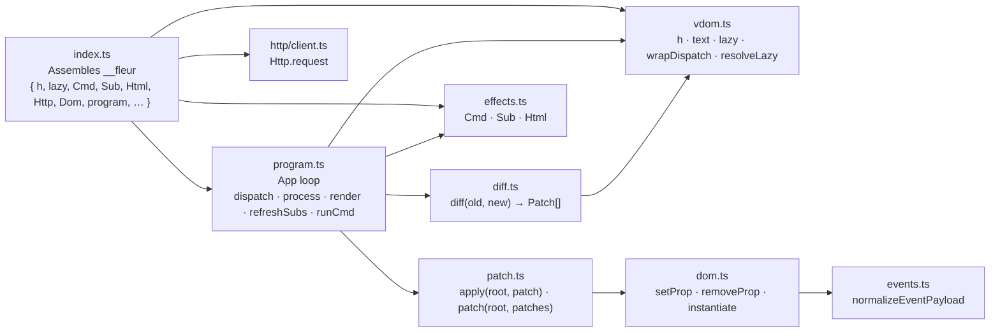
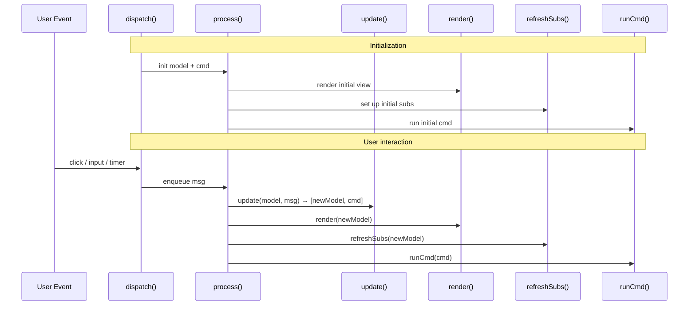
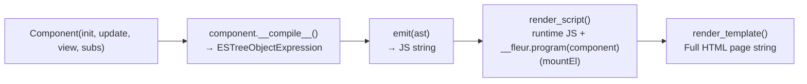
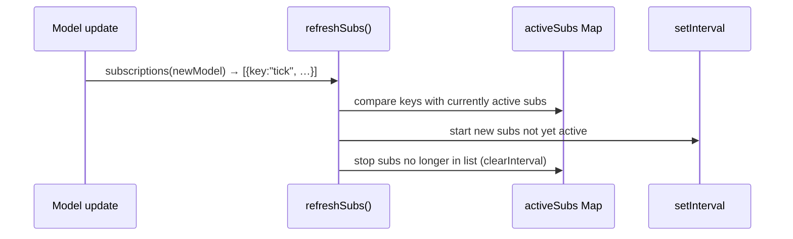
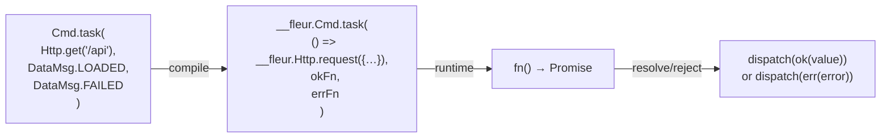

# Fleur Architecture

Fleur is an **Elm-inspired Python-to-browser-UI framework**. Application and UI code is written using the Python DSL. The compiler lowers it to a JavaScript AST, and the browser runs the emitted JavaScript alongside the Fleur runtime bundle.

---

## Table of Contents

1. [High-Level Overview](#1-high-level-overview)
2. [Layer Structure](#2-layer-structure)
   - [Python and JavaScript boundary](#21-python-and-javascript-boundary)
3. [Python DSL Layer (`src/fleur/core/`)](#3-python-dsl-layer-srcfleurcore)
4. [JS AST Layer (`src/fleur/js/`)](#4-js-ast-layer-srcfleurjs)
5. [Browser Runtime (`runtime/`)](#5-browser-runtime-runtime)
6. [Builtins (`src/fleur/builtins/`)](#6-builtins-srcfleurbuiltins)
7. [UI Component Library (`src/fleur/ui/`)](#7-ui-component-library-srcfleurui)
8. [Key Data Flows](#8-key-data-flows)
9. [Component Composition](#9-component-composition)
10. [Subscriptions](#10-subscriptions)
11. [HTTP and Side Effects](#11-http-and-side-effects)
12. [File Structure Reference](#12-file-structure-reference)

---

## 1. High-Level Overview



The entire pipeline has three hard stages:

| Stage | Location | Role |
|---|---|---|
| **DSL compilation** | `src/fleur/core/` | Python objects compile to ESTree AST nodes |
| **JS emission** | `src/fleur/js/` | ESTree AST is serialized to a JavaScript string |
| **Browser runtime** | `runtime/` | TypeScript runtime runs the generated JS in the browser |

---

## 2. Layer Structure



The Python dependencies flow from `ui` to `core`, from `builtins` to `core`
and `js`, and from `core` to `js`.

### 2.1 Python and JavaScript boundary

Built-in UI components use the same public Python DSL as application-defined
views. The Python UI layer defines markup, styling, accessibility attributes,
and interaction rules such as keyboard navigation and when to move focus.
Application state changes through the Elm-style `Model`, `Msg`, and `Update`
loop. Transient state owned by a particular DOM element, such as a timer or a
focus reference, can live in a `DomScope` and be cleaned up with the view.

`fleur.core` exposes typed operations such as `EventBinding`, `DomAction`,
and `DomEffect`. The compiler turns those operations into an AST, which
`fleur.js` emits as JavaScript. The TypeScript runtime executes the message
loop, patches the DOM, schedules commands and DOM effects, and provides
reusable access to browser APIs. The generated application code carries the
component's rules into the browser.

When adding a component, start with native HTML behavior and compose the public
DSL around it. If the DSL lacks an operation, add it to `fleur.core` in terms
that also make sense for a custom view. Compose existing primitives where
possible. Extend the runtime when a new browser capability or scheduling
guarantee needs runtime support. For example, the Python `Dialog` decides
when to open and close the modal, including calling native `close()` when
its effect is removed. The runtime schedules and disposes the effect and
exposes the native dialog methods through the DOM bridge.

---

## 3. Python DSL Layer (`src/fleur/core/`)

### 3.1 `Expr[T]` — the DSL value wrapper

`Expr` (`src/fleur/core/expr.py`) is the central type that wraps any ESTree expression node. All DSL values (model fields, literals, computed results) are `Expr` instances. Python operators are overloaded to produce new `Expr` nodes:

```text
# Python                                  →   ESTree node produced
CounterModel.count + 1                    →   ESTreeBinaryExpression("+", model.count, 1)
Cond.equal(CounterModel.count, 0)         →   ESTreeBinaryExpression("===", model.count, 0)
Boolean.negate(CounterModel.enabled)      →   ESTreeUnaryExpression("!", model.enabled)
```

Calling `__bool__()` raises `TypeError` to prevent accidental use in Python conditionals.

### 3.2 `Model` and `State`

`Model` (`src/fleur/core/model.py`) is the base class for application state. Fields are declared with the `State[T]` descriptor:

```python
class CounterModel(Model):
    count: State[int]
```

`ModelMeta` (the metaclass) scans annotations at class creation time, auto-installs `State` descriptors, and builds a `__state_fields__` tuple that includes inherited fields.

`State` is a descriptor with two behaviors depending on how it is accessed:
- **On the class** (`CounterModel.count`) — returns a `ModelState`, a specialization of `Expr` that represents `model.count` in generated JS. Supports chained attribute access (`model.nested.field`) and f-string interpolation.
- **On an instance** (`model_instance.count`) — returns the `Expr` stored at that field (the current value).

`State.set(field, value)` produces a `ModelUpdate` that compiles to an immutable update:

```js
Object.assign({}, model, { count: model.count + 1 })
```

### 3.3 `MsgGroup` and `Msg`

Users subclass `MsgGroup` to define message variants. `Msg` is a descriptor; when accessed on the subclass it returns a `GroupedMsg`:

```python
class CounterMsg(MsgGroup):
    INC: Msg[PointerEvent] = Msg()
    DEC: Msg[PointerEvent] = Msg()
```

`GroupedMsg` compiles to a JS event-handler factory:

```js
(event) => ({ type: "INC", event: event, context: null })
```

Inside update definitions, `GroupedMsg.event` and `GroupedMsg.context` return proxy objects (`MessageEventRef`, `MessageContextRef`) that accumulate property chains like `message.event.client_x` in generated JS.

`MsgGroup.cases(*cases)` collects `(GroupedMsg, case_value)` pairs into an `Update`.

### 3.4 `Update`

`Update` (`src/fleur/core/update.py`) compiles a `switch` statement dispatching on `message.type`:

```js
function(model, message) {
    switch (message.type) {
        case "INC": return [Object.assign({}, model, {count: model.count + 1}), __fleur.Cmd.none()];
        case "DEC": return [Object.assign({}, model, {count: model.count - 1}), __fleur.Cmd.none()];
        default:    return [model, __fleur.Cmd.none()];
    }
}
```

Each case value can be:
- A `ModelUpdate` alone → paired with `Cmd.none()`.
- A `(ModelUpdate, Cmd)` tuple.
- A `ForwardedUpdate` for child component delegation.

### 3.5 `View`

`View` (`src/fleur/core/view.py`) is a VNode builder. It holds a tag, a props dict, and children. `__compile__()` emits:

```js
__fleur.h("button", { onclick: (event) => ({type:"INC", …}) }, "Increment")
```

Text strings containing `${model.field}` interpolation are parsed by `_compile_text_expr` and compiled to JS string concatenation:

```js
"" + "Count: " + model.count
```

`View.map(tagger, view)` lifts a child view into a parent message space via `__fleur.Html.map`.

### 3.6 `Cmd` and `Sub`

`Cmd` (`src/fleur/core/cmd.py`) represents side effects returned alongside model updates:
- `Cmd.none()` → `__fleur.Cmd.none()`
- `Cmd.map(tagger, cmd)` → `__fleur.Cmd.map(tagger, cmd)`
- `Cmd.task(effect, ok_msg, err_msg)` → `__fleur.Cmd.task(() => <effect>, okFn, errFn)`

`Sub` (`src/fleur/core/sub.py`) represents ongoing subscriptions:
- `Sub.none()` → `__fleur.Sub.none()`
- `Sub.interval(key, ms, tagger)` → `__fleur.Sub.interval("key", ms, taggerFn)`

### 3.7 `Component`

`Component` (`src/fleur/core/component.py`) is the top-level application unit. It holds `init`, `update`, `view`, and `subscriptions`, and compiles to a plain JS object:

```js
{
    init:          function() { return [initialModel, initialCmd]; },
    update:        function(model, message) { /* switch */ },
    view:          function(model) { return __fleur.h(…); },
    subscriptions: function(model) { return __fleur.Sub.none(); }
}
```

The message group is a type parameter of every part, and its variance makes the type checker
enforce that the update handles every message the rest of the component can produce:

- `View[M, G]`, `Cmd[M, G]` and `Sub[M, G]` produce messages. `View` is covariant in `G`, and a
  view's children (`ViewChild[M, G]`) and props (`ViewProps[G]`) carry `G` up to the root.
- `Update[M, G]` is invariant in both `M` and `G`, so a component takes its model and group
  from its update. A covariant parameter would let the checker widen the component to a
  union, and a contravariant group would let a view without typed messages erase it.
- A `GroupedMsg[G, Event, Context]` records the context a dispatcher must still supply.
  `bind()` returns one with `None`, which is what event handlers (`EventMessage[G, Event]`),
  `Cmd.task` and `Sub.interval` accept.
- A tagger for a child component declares the child's group as its event
  (`COUNTER: Msg[CounterMsg]`), so `View.map`, `View.forward`, `Update.forward`, `Cmd.map`
  and `Sub.map` match it against the child. The forwarding helpers also require the field to
  hold the child component's model type.
- Static methods use method-scoped type variables: Pyright does not solve a generic class's
  own parameters from the arguments of its static or class methods.

`MsgGroup.cases()` checks at definition time that every message of the group is handled.
See `tests/typecheck/` for the cases the type checker rejects.

### 3.8 `Cond`

`Cond` (`src/fleur/core/cond.py`) provides conditional expression helpers:
- `Cond.when(cond, consequent, alternate)` → ternary `(cond ? conseq : alt)`
- `Cond.some(*conds)` → `(a || b || c)`
- `Cond.every(*conds)` → `(a && b && c)`

### 3.9 Runtime Constants

`src/fleur/core/runtime.py` defines all string constants used as identifiers in generated JS (e.g. `RUNTIME_NAMESPACE = "__fleur"`, `MODEL_IDENT = "model"`, `MESSAGE_IDENT = "message"`, message field keys). The helpers `runtime_ref(*path)` and `runtime_call(path, *args)` build `__fleur.X.Y` member and call expressions.

### 3.10 Event Protocols

`src/fleur/core/events.py` defines Python `Protocol` classes (`PointerEvent`, `KeyboardEvent`, `InputEvent`, etc.) that mirror the normalized event objects produced by the runtime. These are used as type arguments in `Msg[EventType]` declarations to get typed access to `msg.event`.

---

## 4. JS AST Layer (`src/fleur/js/`)

### 4.1 ESTree AST (`ast.py`)

A full ESTree-compatible Python dataclass hierarchy (all `slots=True`):

```
ESTreeNode
├── ESTreePattern
├── ESTreeExpression
│   ├── ESTreeIdentifier
│   ├── ESTreeLiteral
│   ├── ESTreeArrayExpression
│   ├── ESTreeObjectExpression  (+ ESTreeObjectProperty)
│   ├── ESTreeFunctionExpression
│   ├── ESTreeCallExpression
│   ├── ESTreeMemberExpression
│   ├── ESTreeBinaryExpression
│   ├── ESTreeUnaryExpression
│   ├── ESTreeLogicalExpression
│   ├── ESTreeConditionalExpression
│   └── …
└── ESTreeStatement
    ├── ESTreeReturnStatement
    ├── ESTreeSwitchStatement   (+ ESTreeSwitchCase)
    ├── ESTreeVariableDeclaration
    ├── ESTreeBlockStatement
    └── …
```

### 4.2 Builder Helpers (`builder.py`)

Convenience factory functions for producing ESTree nodes:
- `ident(name)`, `literal(value)`, `member(obj, prop)`, `index_expr(expr, index)`
- `call(callee, *args)`, `object_expr(pairs)`, `json_expr(value)`, `concat(left, right)`

### 4.3 Emitter (`emitter.py`)

`emit(node, settings)` recursively serializes an ESTree node to a JavaScript string. `EmitterSettings` controls indentation and spacing — defaults to minified output (no whitespace).

### 4.4 Promise Combinator (`combinators/promise.py`)

`Promise[V, E, Ref]` represents a JS Promise chain at the Python AST level, supporting `.then(mapper)` to append `.then(value => …)` calls. Used by builtins that need to transform async results before dispatching.

---

## 5. Browser Runtime (`runtime/`)

The runtime is a Bun-built TypeScript project compiled to a single `fleur.js` bundle, exposed on the browser global as `window.__fleur`.



### 5.1 VNode types (`types.ts`)

```
VNode = VText | VElement | VLazy

VText    { type:"TEXT",    value:string }
VElement { type:"ELEMENT", tag, props, children:VNode[] }
VLazy    { type:"LAZY",    fn, args, vnode:VNode|null }   ← memoization
```

**Patch types:** `REPLACE`, `TEXT`, `PROPS`, `INSERT`, `MOVE`, `REMOVE` — each carrying a path (index array) into the DOM tree.

### 5.2 `h` and VNode construction (`vdom.ts`)

`h(tag, props, ...children)` is the VNode constructor called by all generated `__fleur.h(...)` calls. It flattens children and wraps non-VNode values. `wrapDispatch(dispatch, vnode)` deep-walks the VNode tree, wrapping all `on*` function props so calling them invokes `dispatch(msg)` rather than returning a raw message object.

### 5.3 Diffing (`diff.ts`)

`diff(oldVNode, newVNode, path)` computes a minimal `Patch[]`:

1. **Lazy optimization:** if both are `VLazy` with the same `fn` and shallow-equal args, return `[]`.
2. **Type/tag mismatch:** emit `REPLACE`.
3. **`VText`:** compare values → emit `TEXT` patch if different.
4. **`VElement` props:** compute changed/added/removed props → emit `PROPS` patch.
5. **Children — keyed:** if any child has a `key` prop, use key-indexed matching; emit `MOVE`, `INSERT`, `REMOVE` as needed.
6. **Children — unkeyed:** diff pairwise; `REMOVE` trailing; `INSERT` extras.

### 5.4 Patching (`patch.ts`)

`apply(root, patch)` applies a single patch to the DOM tree by following the index path to the target node. `patch(root, patches)` applies all patches in order, threading the root node (which may change on root `REPLACE`).

### 5.5 DOM operations (`dom.ts`)

`setProp(el, key, value)` handles all prop types:
- `className` → `setAttribute("class", …)`
- `style` object → `el.style.setProperty(…)` per entry
- `on*` functions → `addEventListener` (old listener removed first and stored on `el.__listeners`)
- `onCapture:<event>` functions → capture-phase listeners
- `domEffect:<key>` → manage a named effect once the element's props and children are ready
- Anything else → `setAttribute`

Event listeners pass the normalized payload, the registered element, and the
native event to the handler. A handler may return without a message.
DOM effects can read the originating event target through
`DomElement.event_origin(event)`. The runtime carries the origin through queued
messages and deferred DOM effects.

A DOM effect has a `key`, an array of `args`, and a `run(element, ...args)`
callback. Effect identity is scoped to the element. Adding and removing effects
installs or disposes their individual slots on the existing DOM node. Removed
effects are disposed before applying the element's new props. For the same key,
a change of arguments schedules the effect. With `refresh`, changes to
the element or its children also schedule it. With `sync`, the effect runs
immediately after those DOM updates, including during construction before the
element joins the document. Otherwise, effects run in a microtask on connected
elements and coalesce by slot.

The public Python `DomEffect` compiles to an update callback and optional
`mount` and `dispose` hooks. The update uses the latest rendered dependencies.
The runtime calls the mount hook on installation and disposes effects on removal.
Scoped effects use setup callbacks that allocate local state and return update
and disposal hooks. A scoped effect declares typed render-time inputs with
`scope.input()`. Its update refreshes the input bindings shared by the
installed callbacks before running the view's update action. Its listeners and
timers are released on removal.
For an application-directed focus change, `Dom.focus()` supplies a task for
`Cmd.task` and reports the result through the message loop after rendering.

### 5.6 Event normalization (`events.ts`)

`normalizeEventPayload(eventType, event)` converts raw DOM `Event` objects into plain-object payloads matching the Python `Protocol` definitions:
- Pointer/mouse/click → `{ type, pointer_id, client_x, client_y, button, alt, ctrl, shift, meta }`
- Keyboard → `{ type, key, code, repeat, alt, ctrl, shift, meta }`
- Input/change → `{ type, value, checked }` (from `event.target`)
- Focus/blur/submit → `{ type }`

### 5.7 Effects (`effects.ts`)

**`Cmd`** — each factory returns `(dispatch: Dispatch) => void`:
- `Cmd.none()` → no-op
- `Cmd.batch(cmds)` → runs all cmds
- `Cmd.map(tagger, cmd)` → wraps dispatch through tagger
- `Cmd.task(fn, ok, err)` → calls `fn()` (returns a Promise), dispatches `ok(value)` or `err(error)`

**`Sub`** — each factory returns `Subscription[]`:
- `Sub.none()` → `[]`
- `Sub.batch(subs)` → merges arrays
- `Sub.map(tagger, subs)` → re-wraps each subscription's dispatch
- `Sub.interval(key, ms, tagger)` → `Subscription` with `setInterval`/`clearInterval`

**`Html.map(fn, vnode)`** → calls `wrapDispatch` to remap all message-generating handlers.

### 5.8 Application Loop (`program.ts`)



Key implementation details:
- `dispatch` pushes messages onto a queue and calls `process()`.
- `process()` uses a `running` flag to prevent re-entrant loops while draining the queue.
- `render()` calls `view(model)`, wraps the result with `wrapDispatch`, diffs against the previous VNode, and applies patches to the DOM.
- `refreshSubs()` diffs active subscriptions (by key) against the new subscription list — stopping removed ones and starting new ones. Keys prevent duplicate intervals/listeners.

---

## 6. Builtins (`src/fleur/builtins/`)

### `Http`

`Http` (`src/fleur/builtins/http.py`) provides static factories for HTTP tasks:

```python
Http.get("/api/data", expect=Http.expectJson())
Http.request("POST", "/api/data", body={"key": "value"}, expect=Http.expectJson())
```

Both compile to `__fleur.Http.request({method:"GET", url:"/api/data", expect:"json"})`.

At runtime (`runtime/src/http/client.ts`):
- Wraps browser `fetch` with `AbortController` for timeout support.
- Classifies failures into `HttpError.kind`: `network`, `timeout`, `abort`, `decode`, `unknown`.
- Decodes body per `expect` (`"json"` → `response.json()`, `"text"` → `response.text()`).

`HttpError` is a frozen dataclass (`src/fleur/builtins/http.py`) describing failures: `kind`, `message`, `url`, `status`, `status_text`.

---

## 7. UI Component Library (`src/fleur/ui/`)

### 7.1 View Elements

All elements extend `Element` (which extends `View`). Available elements, grouped by role:

- Layout: `Box`, `VStack`, `HStack`, `Grid`/`GridItem`, `Card`, `Divider`, `ScrollArea`, `Toolbar`
- Content: `Text`, `Heading`, `Link`, `Avatar`, `EmptyState`, `Notice`, `Progress`, `Meter`,
  `Table` and its parts, `SortableTableHead`
- Forms: `Form`, `Fieldset`, `Input`, `Textarea`, `NumberField`, `Slider`, `Select`/`Option`,
  `Combobox`, `Checkbox`, `CheckboxField`, `CheckboxGroup`, `RadioGroup`, `Switch`, `Toggle`, `ToggleGroup`
- Disclosure and navigation: `Disclosure`, `Accordion`/`AccordionItem`, `NavigationMenu`/`NavigationMenuGroup`,
  `Menubar`
- Overlays: `Dialog`, `AlertDialog`, `Popover`, `Menu`/`ContextMenu`/`MenuItem`, `Tooltip`, `PreviewCard`, `Toast`

The interactive behavior of these components lives in the private `views/_*_behavior.py`
modules as scoped DOM effects.

`src/fleur/ui/views/base.py` defines `Element`, the shared `View` subclass.
`views/types.py` defines shorthand arguments and token types.
`views/_utils.py` resolves those arguments and merges them into view props.
`themes/elements.css` supplies defaults for the standard controls and layout views.

Menus and interactive overlays use scoped effects for listeners, timers, and
local state. See the [Python and JavaScript boundary](#21-python-and-javascript-boundary)
and [Add DOM behavior to a custom view](docs/building-apps.md#add-dom-behavior-to-a-custom-view).

### 7.2 Theme System

`Theme` (`src/fleur/ui/themes/base.py`) holds palettes, core tokens, and component-level CSS
variable maps. `theme_style_tag()` emits root variables, mode rules, and component styles.

Built-in themes: `DEFAULT_THEME`, `BASIC_THEME`, `ZEN_THEME`.

`apply_theme(page, theme)` appends the theme stylesheet to `page.extra_head_html`.
`ThemeScope` applies token overrides or a selected theme to a subtree.
See [Theming and styling](docs/theming-and-styling.md) for the public API.

### 7.3 View factories

`src/fleur/ui/factories/` contains `field`, which connects a control with its label, description
and validation message, and `tabs`, which takes panels, the selected key and the selection message.

---

## 8. Key Data Flows

### 8.1 From Python to HTML



### 8.2 Counter example end-to-end

**Python:**
```python
class CounterModel(Model):
    count: State[int]

class CounterMsg(MsgGroup):
    INC: Msg[PointerEvent] = Msg()
    DEC: Msg[PointerEvent] = Msg()

app = Component(
    init=CounterModel(count=0),
    update=CounterMsg.cases(
        CounterMsg.INC.then(State.set(CounterModel.count, CounterModel.count + 1)),
        CounterMsg.DEC.then(State.set(CounterModel.count, CounterModel.count - 1)),
    ),
    view=VStack(
        Text(f"Count: {CounterModel.count}"),
        Button("+", onclick=CounterMsg.INC),
        Button("-", onclick=CounterMsg.DEC),
    ),
)
```

**Generated JS (conceptual, whitespace added for clarity):**
```js
{
  init: function() {
    return [{ count: 0 }, __fleur.Cmd.none()];
  },
  update: function(model, message) {
    switch (message.type) {
      case "INC": return [Object.assign({}, model, { count: model.count + 1 }), __fleur.Cmd.none()];
      case "DEC": return [Object.assign({}, model, { count: model.count - 1 }), __fleur.Cmd.none()];
      default:    return [model, __fleur.Cmd.none()];
    }
  },
  view: function(model) {
    return __fleur.h("div", { style: { display: "flex", flexDirection: "column" } },
      __fleur.h("span", {}, "" + "Count: " + model.count),
      __fleur.h("button", { onclick: (event) => ({ type: "INC", event: event, context: null }) }, "+"),
      __fleur.h("button", { onclick: (event) => ({ type: "DEC", event: event, context: null }) }, "-")
    );
  },
  subscriptions: function(model) { return __fleur.Sub.none(); }
}
```

**Browser execution:**
1. Runtime bundle runs → sets `window.__fleur`.
2. `__fleur.program(componentObj)(document.getElementById("app"))` runs.
3. `init()` → `[{count: 0}, Cmd.none()]`.
4. `render()` → `view({count: 0})` → VNode tree. `wrapDispatch` wraps `onclick` handlers. `diff(undefined, vnode)` → full `REPLACE` patch. `patch(commentNode, patches)` → real DOM.
5. User clicks "+": wrapped `onclick` calls `dispatch({type:"INC", event:{client_x:…}, context:null})`.
6. `process()` → `update({count:0}, msg)` → `[{count:1}, Cmd.none()]`.
7. `render()` → `view({count:1})` → new VNode. `diff` → `[{type:"TEXT", path:[0,0], value:"Count: 1"}]`. `patch` sets `textContent`.

---

## 9. Component Composition

Fleur supports nesting child components within a parent component. The DSL provides `Update.forward` and `View.forward` for this purpose.

### 9.1 Model field delegation

```python
class AppModel(Model):
    counter: State[CounterModel]       # nested model field

class AppMsg(MsgGroup):
    COUNTER: Msg[CounterMsg] = Msg()   # tagger: its event is a message of the child group
```

### 9.2 `Update.forward`

`Update.forward(AppModel.counter, counter_component, AppMsg.COUNTER)` compiles to:

```js
(function() {
    var _result = counterUpdate(model.counter, message.event);
    return [
        Object.assign({}, model, { counter: _result[0] }),
        __fleur.Cmd.map(counterTagger, _result[1])
    ];
})()
```

Child messages are delegated to the child's update function; the resulting model is merged back into the parent model immutably; the resulting cmd is lifted into the parent message space via `Cmd.map`.

### 9.3 `View.forward`

`View.forward(AppModel.counter, counter_component, AppMsg.COUNTER)` renders the child component's view and compiles to:

```js
(function(model) { return __fleur.Html.map(counterTagger, counterViewExpr); })(model.counter)
```

The child view is called with the relevant slice of the parent model; all messages from the child view are lifted into the parent via `Html.map`.

---

## 10. Subscriptions

Subscriptions represent ongoing effects that depend on the current model, such as recurring timers.

**Python:**
```python
Sub.interval("tick", 1000, CounterMsg.TICK)
```

**Compiles to:**
```js
__fleur.Sub.interval("tick", 1000, (event) => ({ type: "TICK", event: event, context: null }))
```

**Runtime behavior:**



`refreshSubs()` is called after every model update. Subscriptions are identified by key, preventing duplicates. Removing a subscription from the list returned by `subscriptions(model)` causes the interval to be cleared automatically.

---

## 11. HTTP and Side Effects

### 11.1 Full pipeline



### 11.2 `Cmd.task` compilation

Each task declares its result and error types through `TaskLike[Result, Error]`.
The success and error messages must accept the corresponding payloads.

`Cmd.task(effect, ok_msg, err_msg)` compiles to:

```js
__fleur.Cmd.task(
    () => __fleur.Http.request({ method: "GET", url: "/api/data", expect: "json" }),
    (event) => ({ type: "LOADED", event: event, context: null }),
    (event) => ({ type: "FAILED", event: event, context: null })
)
```

### 11.3 `Http.request` runtime

At runtime, `Http.request` wraps browser `fetch`:
- Attaches an `AbortController` when `timeout_ms` is set.
- Classifies failures into `HttpError.kind`: `network`, `timeout`, `abort`, `decode`, `unknown`.
- Parses the response body according to `expect` (`"json"` or `"text"`).

On success, `dispatch(ok(response))` sends an `HttpResponse` with status, headers, and the decoded body.
On failure: `dispatch(err(httpError))` → dispatches e.g. `{type:"FAILED", event:<HttpError>}`.

---

## 12. File Structure Reference

```
fleur/
├── src/fleur/
│   ├── __init__.py              # Public API: bloom(), emit(), all DSL types
│   ├── types.py                 # JsonValue, ICompilable protocol
│   ├── core/
│   │   ├── runtime.py           # JS identifier constants (__fleur, model, message, …)
│   │   ├── types.py             # TypeVars: ModelT, MsgGroupT, FleurValue, …
│   │   ├── expr.py              # Expr[T] — DSL value wrapper, operator overloads
│   │   ├── model.py             # Model, ModelMeta, State, ModelState, ModelUpdate
│   │   ├── msg.py               # MsgGroup, Msg, GroupedMsg, MessageEventRef
│   │   ├── update.py            # Update, CaseValue, ForwardedUpdate
│   │   ├── view.py              # View, MappedView, ForwardedView
│   │   ├── cmd.py               # Cmd
│   │   ├── sub.py               # Sub
│   │   ├── task.py              # TaskLike generic task base
│   │   ├── component.py         # Component
│   │   ├── cond.py              # Cond (when, some, every)
│   │   ├── dom.py               # DomEffect, DomScope, DomAction, EventBinding, Dom tasks
│   │   ├── events.py            # Event Protocols (PointerEvent, KeyboardEvent, …)
│   │   └── template.py          # Page, BloomContext, render_script, render_template
│   ├── js/
│   │   ├── ast.py               # ESTree-compatible AST dataclasses
│   │   ├── builder.py           # AST factory helpers (ident, literal, call, …)
│   │   ├── emitter.py           # ESTree → JS string serializer
│   │   ├── traverse.py          # Generic ESTree traversal (identifier and binding queries)
│   │   └── combinators/
│   │       └── promise.py       # Promise chain combinator
│   ├── builtins/
│   │   └── http.py              # Http, HttpError
│   ├── ui/
│   │   ├── views/               # Box, Button, Input, Text, VStack, HStack, …
│   │   │                        #   _*_behavior.py: scoped DOM effects for interactive components
│   │   ├── themes/              # Theme, ThemeScope, DEFAULT/BASIC/ZEN themes, elements.css
│   │   └── factories/           # Composite views (field, tabs)
│   ├── integrations/
│   │   └── shadcn/themes.py     # Shadcn-compatible CSS variable mapping
│   ├── cli/                     # CLI entrypoint
│   └── assets/fleur.js          # Pre-built runtime bundle (output of make build)
│
├── runtime/
│   └── src/
│       ├── index.ts             # Assembles window.__fleur (h, lazy, Cmd, Sub, Html, Http, Dom, program, …)
│       └── core/
│           ├── types.ts         # VNode, Patch, Msg, Dispatch, Subscription, …
│           ├── vdom.ts          # h, text, lazy, wrapDispatch, resolveLazy
│           ├── diff.ts          # diff(old, new) → Patch[]
│           ├── patch.ts         # apply(root, patch), patch(root, patches)
│           ├── dom.ts           # setProp, removeProp, instantiate
│           ├── domAccess.ts     # Dom: element operations used by compiled DOM actions
│           ├── domEffect.ts     # Install, update and dispose element-scoped effects
│           ├── array.ts         # sortBy
│           ├── events.ts        # normalizeEventPayload
│           ├── effects.ts       # Cmd, Sub, Html
│           └── program.ts       # program() — app loop
│       └── http/
│           ├── types.ts         # HttpRequest, HttpError types
│           └── client.ts        # Http.request (wraps fetch)
│
└── tests/
    ├── unit/
    │   ├── core/                # Tests for Model, Msg, Expr, etc.
    │   ├── builtins/            # Tests for Http
    │   ├── js/                  # Tests for AST/emitter
    │   ├── integrations/        # Tests for the shadcn theme importer
    │   └── ui/                  # Tests for UI elements and themes
    ├── typecheck/               # Pyright-only checks for DSL typing contracts
    └── integration/
        ├── core/                # Cross-layer tests (component composition, etc.)
        ├── cli/                 # fleur dev reload server
        └── ui/                  # Browser tests (Playwright probes in *.cjs)
```
